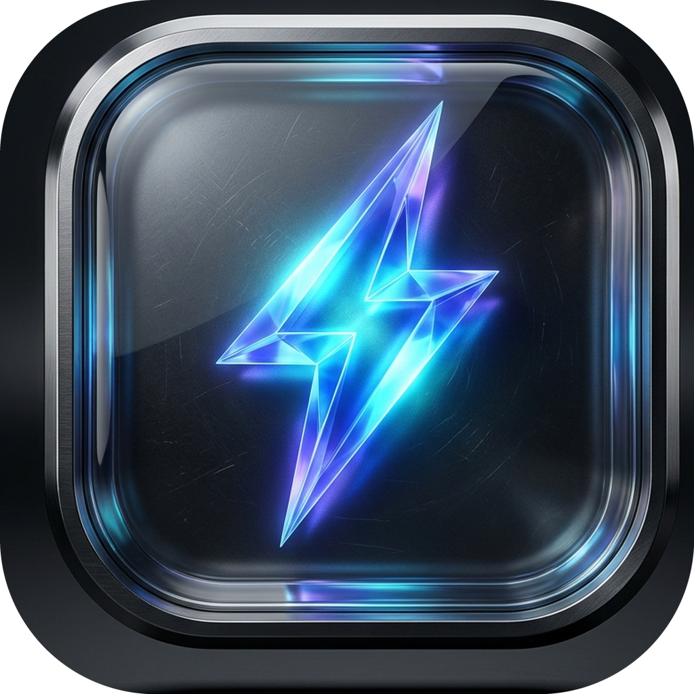

<p align="center">
  
</p>

# ⚡️ VibeArmory (Vibe 军火库)

<p align="center">
  
  
  
  
  
</p>

> **专为 Vibe Coding 与 Agent 深度使用者打造的轻量级 macOS 原生“认知协同外挂”。**  
> 告别繁琐填空的传统模板，按“痛点症状”一键装弹，把上下文提取的苦力压榨给 Agent 本身。

---

## 💡 为什么需要 VibeArmory？

在与 Cursor、Windsurf、Claude Code、Antigravity 等 Agent 协作编码时：
- **从 0 到 1 容易，到了“修改 / 迭代”阶段却频繁崩溃**：新手极易陷入“改 A 坏 B”、“越改越乱”、“样式塑料风”、“Agent 失忆”的打地鼠死循环。
- **不同人的产出方差极大**：不是 Agent 能力不行，而是人机交互的认知框架与提问习惯拉开了银河般的差距。
- **传统提示词模板反人类**：动辄几百字、带大量 `【请在此填写上下文、目标和现实约束】`，在频繁修改的心流中，光填空就能把人逼疯。

**VibeArmory 的解法：**
1. **零输入设计（Zero-Input）**：提示词不留填空位，直接命令 Agent 自行扫描 Git Diff、项目规范、调用链路，自己吃上下文。
2. **大白话症状索引（Symptom-Driven）**：不搞学术名词，全按你此刻抓狂的症状分类（“样式像毛坯房”、“逻辑打架变成屎山”、“AI 陷入盲改死循环”）。
3. **极简极速交互（Zero-Friction）**：纯原生 Swift + SwiftUI，常驻菜单栏，随时按 `⌥P` 呼出毛玻璃 HUD，一键回车复制即退隐，光标直接回到原窗口，直接 `⌘V` 上屏！

---

## 🎯 官方预置 22 大重装武器库 (7 大高敏实战战区)

| 战区 | 武器代号 | 痛点症状（大白话） | 核心机制与治理目标 |
| :---: | :--- | :--- | :--- |
| **🔭 动手前调研** | 🔭 **开源先验调研与架构摸底** | 动手写代码前，先摸清相似成熟项目的架构与共性 | 检索 GitHub 3~5 个高星相似项目，解构目录与模块共性，推导 MVP 范围与暗坑 |
| **🔭 动手前调研** | 🎯 **范例逆向拆解模式提炼** | 看到别人做的好产品或优秀源码，想提炼精髓内化 | 逆向解构优秀范例，提炼跨项目可复用的工业级模式与当前落地清单 |
| **🔭 动手前调研** | 🧭 **苏格拉底反向需求对齐** | 需求模糊、双方理解不在同一频道、做出来跑偏 | 严禁写代码，单问推进澄清业务假设，冻结 Definition of Done 验收契约 |
| **🔭 动手前调研** | 📑 **工业级 B端 PRD 全维脚手架** | 拿到需求脑子一片乱，需要高标准规范的 B端 系统方案 | 阶段 0 定型、Mermaid 架构/时序/状态机三图合一、数据字段与 RBAC 权限矩阵 |
| **🔭 动手前调研** | 🔥 **伪需求残酷粉碎机** | 业务或老板提了个想法，不知道该不该做、做多大 | 从真实痛点、频次体量、综合 ROI 三关审讯，下达【毙掉/极度瘦身/推进】判决 |
| **💥 越改越乱** | 🧩 **第一性原理降维重构** | 代码到处打补丁、改 A 坏 B、屎山不敢碰 | 剥离表面妥协代码，调取 Git Diff 回归底层纯粹单向状态机 |
| **💥 越改越乱** | 🌐 **跨领域机制借解** | 业务逻辑极臃肿、常规套路陷入死胡同 | 抽象底层矛盾，跨界借用游戏循环、断路器、事件溯源机制 |
| **💥 越改越乱** | 🧹 **上下文净化与架构归位** | 会话进行几十轮、Agent 逻辑混乱打转 | 清空短期聊天缓存，以本地 Git 真实文件为单一信源校准基线 |
| **🐛 报错死循环** | 🩺 **多维度专家会诊质询** | 方案犹豫不决、复杂问题容易顾此失彼 | 虚拟 3 位互补架构师互撕质询，输出综合仲裁方案与单点验证 |
| **🐛 报错死循环** | 🔬 **最小可复现实验 (MRE)** | 报错频繁、AI盲猜越改越烂、编译太慢 | 严禁直接改代码，提出 3 种互斥假设并编写最小隔离脚本证实/证伪 |
| **🛑 别瞎动乱改** | 🛡️ **爆炸半径防御门禁** | AI 擅自改无关文件、偷懒删除已有注释 | 范围冻结 + 微创手术原则，锁定只允许变动的单一核心 |
| **🛑 别瞎动乱改** | ⚡️ **规范唤醒与 Skill 校验** | Agent 改着改着失忆，把既定 rules 抛脑后 | 强制重新阅读 rules/skills，表格形式举证自检违规项与自检重构 |
| **🛑 别瞎动乱改** | 🔀 **全状态机与极端异常流扫描** | 需求只写正常路径，研发一问异常/逆向就漏洞百出 | 绘制状态机，输出《状态流转矩阵表》，地毯式扫描并发、断网、逆向撤销冲突 |
| **🛑 别瞎动乱改** | ✂️ **敏捷需求拆解与 MVP 刀法** | 需求无休止膨胀、一期做太大无法上线 | 锁定单一主回路，运用 P0 骨架刀、P1 肌肉刀精准分类，输出解耦 User Story |
| **🧐 上线前挑刺** | 🧐 **上线前防御性代码审查** | AI 宣称搞定但心里没底，上线前严查边界与暗坑 | 设立海量用户/脏数据/并发极限假设，按严重程度 P0/P1/P2 地毯式挑刺 |
| **🧐 上线前挑刺** | 🛡️ **上线前防御性产品逻辑审查** | 功能即将上线，排查死胡同、资损羊毛与逻辑死穴 | 地毯式排查业务闭环、逆向流双向对齐、角色越权穿透与新老兼容冲突 |
| **🧐 上线前挑刺** | ⚖️ **双向钢人论证技术抉择** | 面临二选一两难抉择（重构vs修补、方案A vs B） | 为对立双方做最强版本辩护，挖掘决定胜负的关键变量与硬核追问 |
| **🧐 上线前挑刺** | 🕵️ **需求评审防翻车 (模拟暴躁 Tech Lead)** | PRD 准备过评审，担心被技术架构师怼飞问倒 | 毒舌找茬技术可行性、并发一致性、历史包袱，输出 5 个致命题及防翻车答案 |
| **🧐 上线前挑刺** | 🔍 **代码实现与 PRD 偏离度核查** | 代码写完担心偷工减料，很多隐性规则未实现 | 将 PRD 与源码逐行对照，深挖字段校验、空状态、权限校验与异常吞并重灾区 |
| **🧐 上线前挑刺** | 📋 **等价类与极端边界用例穷举** | 缺乏完整测试用例，不知道自测测什么容易出事故 | QA Lead 视角输出有效/无效等价类、极限边界值与时序中断测试矩阵表 |
| **✨ 界面太塑料** | 🎨 **界面去塑料与设计系统归位** | 色彩圆角不统一、间距压抑、假数据出戏、缺少空状态 | 绑定设计 Token，统一步长网格与同心圆角，注入真实业务数据并补齐空状态 |
| **💡 看不懂底层** | 🧠 **双层概念穿透与认知脱盲** | 遇到看不懂的底层机制、协议或复杂报错 | 第一层小白生活化类比 + 第二层资深专家严密机制与真实工程边界 |

---

## ⬇️ 下载与运行指南

VibeArmory 为纯原生构建，原生支持 **Apple Silicon (M1/M2/M3/M4) 与 Intel 双架构通用二进制**，开箱即用，无需安装任何额外依赖或运行时环境。

### 1. 下载预编译包
前往项目的 [Releases 页面](https://github.com/a916791360/VibeArmory/releases) 下载最新的 `VibeArmory-v0.1.4-macOS-Universal.zip` 并解压。

### 2. 首次运行与安全提示说明（macOS Gatekeeper）
> **说明**：本项目为开源独立个人软件，未向苹果年缴 $99 申请商业证书。macOS 默认的安全门禁（Gatekeeper）在初次双击从未经 Apple 公证的外部来源下载的 App 时，可能会弹出提示 *“无法验证开发者”* 或 *“已损坏，无法打开”*。

你可以通过以下任一方式无缝打开：
- **方案 A（系统偏好设置一键放行 · 推荐）**：  
  打开 macOS **「系统设置」 ➔ 「隐私与安全性」**，滑到下方看到 *“已阻止使用 VibeArmory，因为来自身份不明的开发者”*，点击 **【仍要打开】** 即可正常使用。
- **方案 B（右键打开）**：  
  按住 `Control` 键单击（或右键）`VibeArmory.app`，在弹出菜单中点击 **「打开」**，随后在弹窗中再次点击 **「打开」**。
- **方案 C（终端一劳永逸解除隔离属性）**：  
  ```bash
  xattr -cr /Applications/VibeArmory.app
  ```

---

## 🖥️ 苹果原生液态玻璃架构 (macOS Native Two-Column)

VibeArmory 采用真正的 macOS 原生两栏架构（**左侧战区导航栏 + 右侧主武器库**）：
- **左侧磨砂战区栏（Sidebar）**：垂直罗列所有战区，实时显示各战区武器数量 Badge，彻底告别单行横滑截断，支持未来无限扩展；
- **右侧 Spotlight 主战区**：集成式高光搜索框、无多余装饰的高密度卡片列表、一键装弹快捷键；
- **纯正 Apple 原生材质**：底层采用 AppKit `NSVisualEffectView` 硬件加速 popover 材料与菲涅尔镜面反射，丝滑细腻。

---

## ⌨️ 快捷交互与操作方式

* **全局唤醒**：按下 **`Option + P`**（或 `Cmd + Option + P`），屏幕中央弹出 HUD 面板；
* **菜单栏常驻**：点击 macOS 菜单栏图标也可随时展开；
* **上下翻选**：`↑` / `↓` 方向键浏览不同武器，列表自动同步滚动；
* **即刻装弹**：按 `Enter` 回车或鼠标单击，提示词写入剪贴板，HUD 瞬间隐退，自动归还输入焦点；
* **直接开火**：切回 Cursor / Agent 窗口，直接按 **`Cmd + V`** 回车发送！
* **深度预览**：点击卡片右侧的 **眼睛图标**，无缝横滑展开完整提示词并支持自由复制；
* **退出隐退**：按 `Esc` 或点击外部空白处，瞬间隐藏；
* **右键设置**：右键菜单栏图标，可一键新增自定义提示词、一键恢复官方预置。

---

## 🛠️ 构建与运行

### 方式 1：直接运行构建脚本打包为 `.app`
```bash
git clone https://github.com/a916791360/VibeArmory.git
cd VibeArmory
./scripts/build_app.sh
open dist/VibeArmory.app
```

### 方式 2：使用 Swift 命令行直接运行
```bash
swift run VibeArmory
```

### 方式 3：使用 Xcode 开发调试
双击项目根目录下的 `Package.swift` 即可直接使用 Xcode 打开并进行断点调试与开发。

---

## 📄 开源许可

[MIT License](LICENSE) © 2026 a916791360
